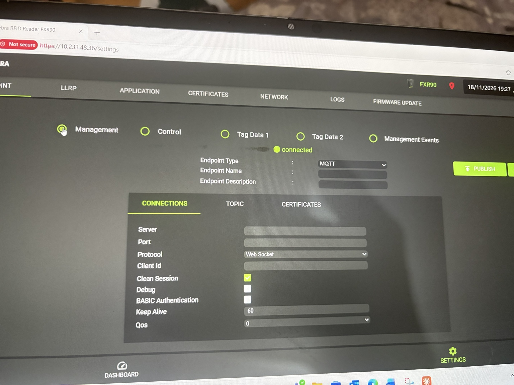
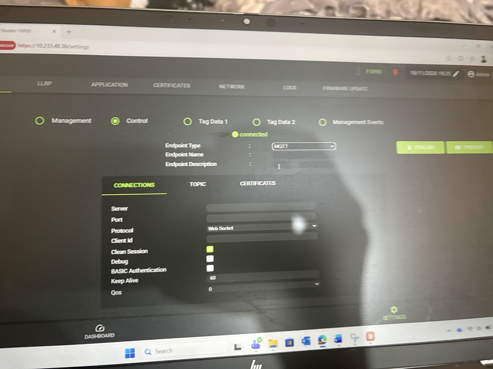
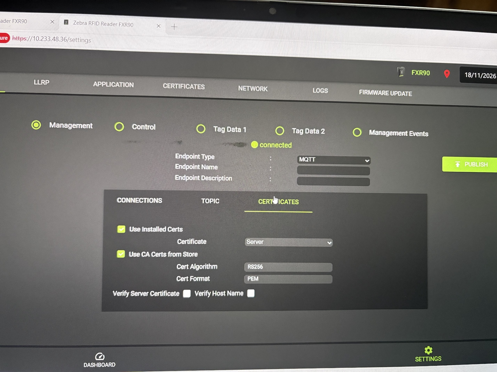
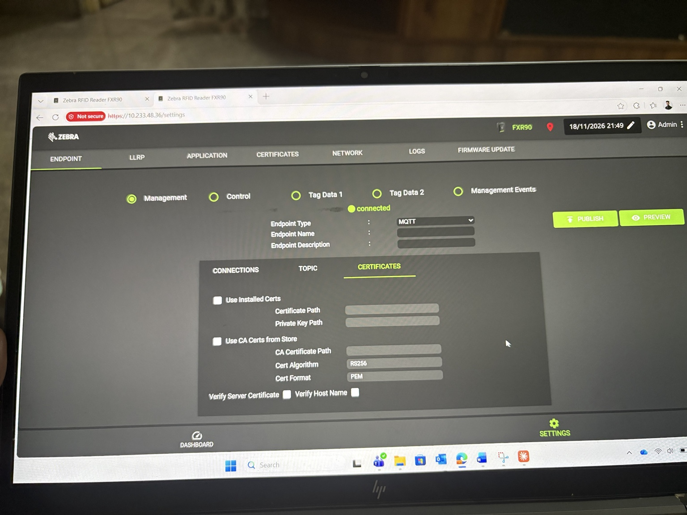
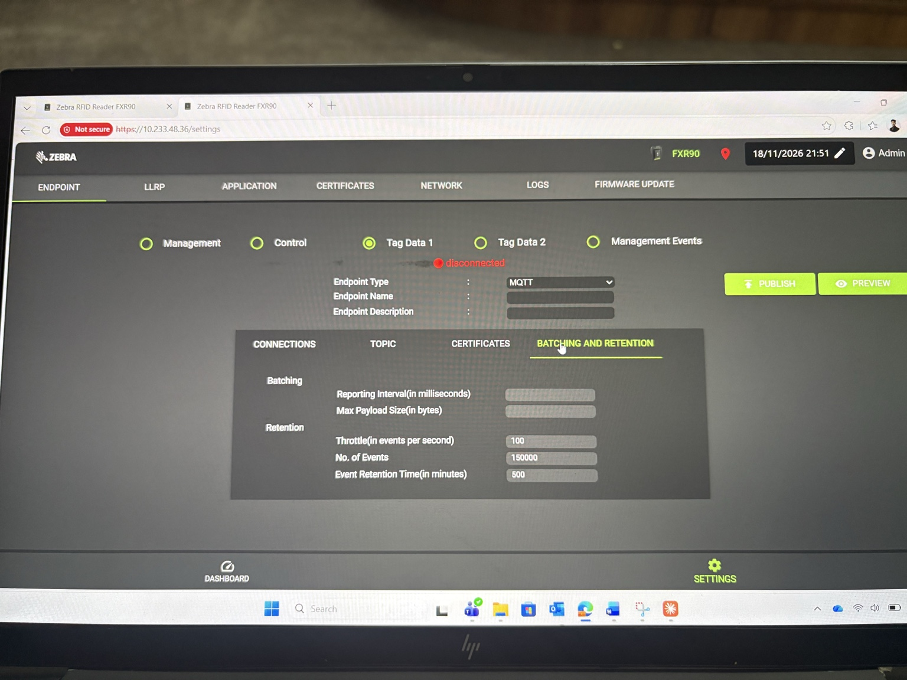

Connect a reader interface to an MQTT broker so that your application can send commands to the reader and receive responses, tag data, or management events. When you finish, the interface shows **Connected** and messages flow between the reader and the broker.

**Applies to:** All FXR fixed readers.

:::note
Each interface has its own endpoint configuration. Configure the interfaces your application needs one at a time by repeating Steps 1–6. Interfaces can use the same MQTT broker or different brokers.
:::

## Before You Begin

- Sign in to the Reader Web Interface as an **Admin** user.
- Make sure the reader can reach the broker over the network.
- Collect the following values for each interface you configure:

| You need | Example | Notes |
| --- | --- | --- |
| Broker hostname or IP address | `broker.example.com` | — |
| Port | `1883` | Use the port configured on your broker for the selected protocol. |
| Protocol | TCP | TCP, TLS, WebSocket, or Secure WebSocket. |
| Client ID | `fxr-dock01-mgmt` | Must be unique for each connection to the broker. |
| Username and password | — | Only if the broker requires authentication. |
| Topic names | `site/dock01/mgmt/cmd` | Defined by you and your application. |
| Certificates | — | Only for TLS or Secure WebSocket. PEM format, RSA key. |

To configure the connection with an API instead of the Reader Web Interface, see [Configure Using the API](#configure-using-the-api).

## Choose an Interface

Select the interface that matches what your application needs to do.

| If you want to… | Configure |
| --- | --- |
| Configure or manage the reader | [Management](../introduction/ziotc-interfaces.mdx#management-interface) |
| Start or stop RFID inventory | [Control](../introduction/ziotc-interfaces.mdx#control-interface) |
| Send tag observations to an application | [Tag Data 1 or Tag Data 2](../introduction/ziotc-interfaces.mdx#data-interface) |
| Receive reader events, such as heartbeats and warnings | [Management Events](../introduction/ziotc-interfaces.mdx#management-events-interface) |

You can configure up to two Tag Data interfaces: **Tag Data 1** and **Tag Data 2**.

**Example:** To start reading tags and send the observations to an application, configure both **Control** and **Tag Data 1**.

For more information, see [ZIoTC Interfaces](../introduction/ziotc-interfaces.mdx).

{/* TODO: confirm with engineering whether publishing a change to the Management interface interrupts an active remote management session. If it does, add a caution here. */}

## Step 1: Open the Endpoint Settings

1. Sign in to the Reader Web Interface.
2. Go to **Settings > Endpoint**.
3. Select the interface you want to configure.
4. Set **Endpoint Type** to **MQTT**.
5. Enter an **Endpoint Name** and an **Endpoint Description**. Both fields are required.



<p className="figure-caption"><strong>Figure 1:</strong> Select an interface on the Endpoint page.</p>

## Step 2: Enter the Connection Settings

Select the **Connections** tab and enter the broker settings for the selected interface.



<p className="figure-caption"><strong>Figure 2:</strong> MQTT connection settings for the selected interface.</p>

| Field | Description | Default |
| --- | --- | --- |
| **Server** | The broker hostname or IP address. | — |
| **Port** | The broker's listening port for the selected protocol. MQTT over TCP commonly uses `1883`, and MQTT over TLS commonly uses `8883`. | — |
| **Protocol** | The transport the broker listens on: **TCP**, **TLS**, **WebSocket**, or **Secure WebSocket**. | — |
| **Client Id** | A unique identifier for this connection. If two active connections use the same client ID, the broker can disconnect one of them. | — |
| **Clean Session** | When enabled, the broker starts a new session each time the reader connects and does not keep subscriptions or queued messages from a previous session. | Enabled |
| **Debug** | Records connection details for troubleshooting. Leave it disabled during normal operation. | Disabled |
| **BASIC Authentication** | When enabled, enter the broker **Username** and **Password**. | — |
| **Keep Alive** | The maximum time, in seconds, between messages. If no message is sent within this time, the reader sends a ping to keep the connection open. | `60` |
| **Qos** | The MQTT quality of service: `0` (at most once), `1` (at least once), or `2` (exactly once). | `0` |

{/* TODO: confirm the secure port shown in the Reader Web Interface. Zebra API examples use 8883 for TLS; a value of 1888 was also reported. */}

The settings take effect when you publish the configuration in Step 6.

## Step 3: Set the Topics

Select the **Topic** tab and enter the topics for the selected interface.

- Topic names are defined by you. The reader does not fill them in.
- MQTT wildcards (`+` and `#`) are not supported.
- The **Command Topic** and **Response Topic** of an interface must be different.
- Use the same topic names in your application and in the broker's access rules.

| Interface | Field | Purpose | Example |
| --- | --- | --- | --- |
| **Management** | **Command Topic** | The reader subscribes to this topic to receive management commands. | `site/dock01/mgmt/cmd` |
| **Management** | **Response Topic** | The reader publishes management responses to this topic. | `site/dock01/mgmt/rsp` |
| **Control** | **Command Topic** | The reader subscribes to this topic to receive control commands. | `site/dock01/ctrl/cmd` |
| **Control** | **Response Topic** | The reader publishes control responses to this topic. | `site/dock01/ctrl/rsp` |
| **Tag Data 1** or **Tag Data 2** | **Publish Topic** | The reader publishes tag observations to this topic. | `site/dock01/tags` |
| **Management Events** | **Publish Topic** | The reader publishes management events to this topic. | `site/dock01/events` |

## Step 4: Add Certificates (TLS and Secure WebSocket Only)

:::note
Complete this step only if you selected **TLS** or **Secure WebSocket** in Step 2. Otherwise, continue to Step 5.
:::

Certificates must be in **PEM** format with an **RSA** key. Upload them to the reader on the **Certificates** page before you start this step. See [Install and Manage Certificates](../security/install-and-manage-certificates.mdx).

Select the **Certificates** tab. If the broker requires client certificate authentication, choose one of the following options.

### Option A: Use an Installed Certificate

1. Select **Use Installed Certs**.
2. In the **Certificate** list, select the client certificate for this connection.



<p className="figure-caption"><strong>Figure 3:</strong> Certificate settings using an installed certificate.</p>

### Option B: Use Certificate File Paths

1. Clear **Use Installed Certs**.
2. In **Certificate Path**, enter the absolute path to the client certificate on the reader.
3. In **Private Key Path**, enter the absolute path to the matching private key.



<p className="figure-caption"><strong>Figure 4:</strong> Certificate settings using file paths.</p>

### Set the CA Certificate and Verification

1. Choose how the reader gets the CA certificate that validates the broker:
   - **From the reader's store:** Select **Use CA Certs from Store**.
   - **From a file:** Clear **Use CA Certs from Store** and enter the absolute path in **CA Certificate Path**.
2. Set **Cert Algorithm** to **RSA** and **Cert Format** to **PEM**.
3. Select **Verify Server Certificate** and **Verify Host Name**.

:::caution[Keep certificate verification enabled]
**Verify Server Certificate** and **Verify Host Name** confirm that the reader is connecting to your broker and not to an impersonator. Disable them only for testing in an isolated network.
:::

## Step 5: Set Batching and Retention (Tag Data and Management Events Only)

:::note
Complete this step only for **Tag Data 1**, **Tag Data 2**, or **Management Events**. For **Management** or **Control**, continue to Step 6.
:::

Select the **Batching and Retention** tab.



<p className="figure-caption"><strong>Figure 5:</strong> Batching and retention settings for Tag Data 1.</p>

**Batching** groups observations into messages. The reader sends a batch when either the reporting interval or the maximum payload size is reached, whichever comes first.

| Field | Description |
| --- | --- |
| **Reporting Interval (in milliseconds)** | How long the reader waits before sending a batch. |
| **Max Payload Size (in bytes)** | The maximum size of one message. |

**Retention** holds events when delivery is delayed, such as during a connection interruption.

| Field | Description |
| --- | --- |
| **Throttle (in events per second)** | The rate at which the reader sends events. |
| **No. of Events** | The maximum number of events the reader holds. |
| **Event Retention Time (in minutes)** | How long the reader holds events before discarding them. |

For guidance on choosing values, see [Batching and Retention](./overview.mdx#batching-and-retention).

## Step 6: Publish and Confirm the Connection

1. Confirm that the correct interface is selected.
2. Select **Preview** and review the connection, topic, certificate, and batching and retention settings.
3. Select **Publish** to apply the configuration.
4. Check that the interface status shows **Connected**.

{/* TODO: add a screenshot showing where the Connected status appears. */}

If the status does not change to **Connected**, see [Troubleshooting](#troubleshooting).

To configure another interface, select it and repeat Steps 1–6.

## Verify Communication

**Connected** confirms that the reader reached the broker. To confirm that messages flow, use an MQTT client. This example uses [MQTTX](https://mqttx.app/); other clients work in a similar way.

### Connect the Client

1. Install and open MQTTX, and create a new connection.
2. Enter the broker address and port used by the interface you want to test.
3. Enter a client ID that is different from the reader's client IDs.
4. If the broker requires them, enter the username, password, and TLS certificates.
5. Select **Connect**.

If your interfaces use different brokers, create one MQTTX connection for each broker.

### Subscribe to the Reader Topics

Select **New Subscription** and subscribe to the topics you want to monitor:

| Interface | Subscribe to |
| --- | --- |
| **Management** | The Management **Response Topic** |
| **Control** | The Control **Response Topic** |
| **Tag Data 1** / **Tag Data 2** | The Tag Data **Publish Topic** |
| **Management Events** | The Management Events **Publish Topic** |

### Test the Management Interface

Publish a management command to the Management **Command Topic** and confirm that a response arrives on the Management **Response Topic**. For example, send [`get_status`](https://immanuel2504.github.io/fxr60-90-rest-mqtt/mqtt/docs/index.html#op-get_status):

{/* TODO: confirm the get_status request fields (command_id or requestId) against the FXR MQTT API reference, and replace the reference link with the official MQTT API address. */}

```json title="get_status request"
{
  "command": "get_status",
  "command_id": "test-status-01",
  "payload": {}
}
```

### Test the Control and Tag Data Interfaces

To start inventory, receive a tag observation, and stop inventory, follow [Quickstart: Read a Tag and Send Data through MQTT](../getting-started/quickstart-first-tag-to-mqtt-in-15-minutes.mdx).

### Test the Management Events Interface

Wait for an enabled event, such as a heartbeat, and confirm that it appears on the Management Events **Publish Topic**. Heartbeats are sent at the interval set in the reader's management event configuration (`managementEventConfig.heartbeat.interval`, in seconds). An interval of `0` turns heartbeats off. See the [Heartbeat reference](https://immanuel2504.github.io/fxr60-90-rest-mqtt/mqtt/docs/index.html#op-heartbeat).

### Check the Status with the REST API

Call [`GET /cloud/status`](https://techdocs.zebra.com/dcs/rfid/fxr-api-docs/rest/docs/swagger#/System/getStatus) and check `interfaceConnectionStatus`. Each configured connection shows `connectionStatus: connected` and an empty `connectionError`.

REST calls require a bearer token. Get one by calling `GET /cloud/localRestLogin` with **Admin** credentials, and then send it in the `Authorization: Bearer <token>` header.

<span id="api-option-configure-an-mqtt-endpoint" />
<span id="rest-api-option-configure-mqtt-endpoints" />

## Configure Using the API

Instead of Steps 1–6, you can send the whole endpoint configuration in one request:

- **MQTT:** If the **Management** interface is already connected, send [`set_importCloudConfig`](https://immanuel2504.github.io/fxr60-90-rest-mqtt/mqtt/docs/index.html#op-set_importCloudConfig) to the Management **Command Topic**.
- **REST:** Send [`PUT /cloud/cloudConfig`](https://techdocs.zebra.com/dcs/rfid/fxr-api-docs/rest/docs/swagger#/System/setImportcloudconfig) to the reader with a bearer token.

The request contains an `endpointConfig` object with a section for each interface: `management.commandResponse`, `control.commandResponse`, `data.event`, and `management.event`. Include only the sections you are configuring. Use connection type `mqtt` for a standard MQTT broker.

```json title="Example: Tag Data over MQTT with TLS"
{
  "endpointConfig": {
    "data": {
      "event": {
        "connections": [
          {
            "name": "DATA_MQTT_TLS",
            "description": "Tag data to the site broker",
            "type": "mqtt",
            "options": {
              "enableSecurity": true,
              "endpoint": { "hostName": "broker.example.com", "port": 8883, "protocol": "ssl" },
              "additional": { "clientId": "fxr-dock01-data", "cleanSession": true, "keepAlive": 60, "qos": 1 },
              "publishTopic": ["site/dock01/tags"],
              "security": {
                "installedCertificateName": "DOCK01_CLIENT",
                "installedCertificateType": "client",
                "keyAlgorithm": "RS256",
                "keyFormat": "PEM",
                "verifyHostName": true,
                "verifyPeer": true
              }
            }
          }
        ]
      }
    }
  }
}
```

After you apply the configuration, confirm it as described in [Verify Communication](#verify-communication).

## Troubleshooting

| Symptom | Likely cause | What to do |
| --- | --- | --- |
| The status does not change to **Connected**. | The server, port, or protocol does not match the broker, or the reader cannot reach the broker. | Check the values against the broker's listener settings, and check the network path from the reader to the broker. |
| The connection drops and reconnects repeatedly. | Another client is using the same **Client Id**. | Give each connection a unique client ID. |
| A TLS connection fails. | The CA certificate does not match the broker's certificate, the broker host name does not match its certificate, or a certificate is not in PEM format with an RSA key. | Check the certificates on the **Certificates** page and make sure **Server** matches the name in the broker's certificate. |
| The broker rejects the connection. | The username or password is wrong, or **BASIC Authentication** is not enabled. | Enable **BASIC Authentication** and re-enter the credentials. |
| The status is **Connected**, but no messages arrive. | The topic names do not match, the client is subscribed on a different broker, or the broker's access rules block the topic. | Check that the topic names match exactly on the reader, the client, and the broker. |

To collect more detail, enable **Debug** in Step 2 while you troubleshoot, and disable it afterward. For more help, see [Network, MQTT, and Cloud Connectivity Issues](../troubleshooting/network-mqtt-and-cloud-connectivity-issues.mdx).

## Related Topics

- [How do I connect to AWS IoT Core?](./connect-to-aws-iot-core.mdx)
- [How do I connect to Azure IoT Hub?](./connect-to-azure-iot-hub.mdx)
- [How do I configure batching and retention?](./configure-batching-and-retention.mdx)
- [ZIoTC Interfaces](../introduction/ziotc-interfaces.mdx)
- [Install and Manage Certificates](../security/install-and-manage-certificates.mdx)
